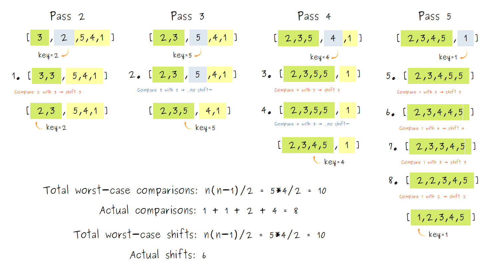

# Insertion Sort in TypeScript
Insertion Sort divides the array into a sorted and an unsorted portion.
The algorithm repeatedly takes the next element from the unsorted side, compares it with elements in the sorted portion, 
and places it in its correct position.

It is called Insertion Sort because each new element is "inserted" into its proper place in the already sorted portion.

## How Insertion Sort Works

- Start a **pass** from the second element to the end of the array.
- Save the current element in a temporary variable called **key**.
  - Compare the **key** with elements in the sorted portion (left side of the array).
  - As long as elements are greater than the **key**, keep **shifting** them to the right.
- Insert the **key** after the last smaller element (or at the start).
- Repeat passes until the array is sorted.

## Insertion Sort Pseudocode
```
INSERTION SORT(A)
for j = 2 to A.length 
    key = A[j]
    // Insert A[j] into the sorted sequence A[1 .. j-1]
    i = j - 1
    while i > 0 and A[i] > key
        A[i + 1] = A[i]
        i = i - 1
    A[i + 1] = key
```
## Insertion Sort Visualization


## Complexity Analysis

### Worst Case
For a reversed array like [5, 4, 3, 2, 1], Insertion Sort performs a shift on every comparison, 
requiring the maximum number of comparisons with every element in the sorted portion of the array.

- Total comparisons: `1 + 2 + 3 + ... + (n-1) = n(n-1)/2`
- Total shifts: `1 + 2 + 3 + ... + (n-1) = n(n-1)/2`
- Total operations: `comparisons + shifts = n(n-1)`
- Time Complexity: **O(n²)**

### Average Case
- Total comparisons: `1/2 * n(n-1)/2 ≈ n(n - 1)/4`
- Total shifts: `1/2 * n(n-1)/2 ≈ n(n - 1)/4`
- Total operations: comparisons + swaps `≈ n²/4`
- Time Complexity: **O(n²)**

### Best Case
For an already sorted array like [1, 2, 3, 4, 5], Insertion Sort completes in a single pass with 
only one comparison per element and no shifts needed.

- Total comparisons: `n - 1`
- Total shifts: `0`
- Time Complexity: **O(n)**

### Space Complexity
Insertion Sort is an in-place algorithm, meaning it sorts elements directly within the same array and does not create extra arrays or lists.

The only additional memory used is a few variables, such as loop counters and a temporary variable to hold the **key** element being inserted.

- Space complexity: **O(1)** (constant memory)

### Complexity Summary
In the worst case, Insertion Sort makes exactly (n² - n)/2,
which simplifies to **O(n²) time complexity** when dropping constants and lower-order terms.

It also has **O(1) space complexity**, since it is in-place and only uses a few extra variables.

## Insertion Sort Implementations in TypeScript

```ts
function insertionSort(array: number[]): number[] {
  // Keep the classic `n` to represent the array size, useful for discussing time complexity.
  const n = array.length;

  for (let pass = 1; pass < n; pass++) {
    const key = array[pass]; // the element we want to insert
    let index = pass - 1; // last index of the sorted portion

    // Shift elements in the sorted portion to the right to make space
    while (index >= 0 && array[index] > key) {
      array[index + 1] = array[index];
      index--;
    }

    // Place the element in its correct position
    array[index + 1] = key;
  }
  
    return array;
}
```