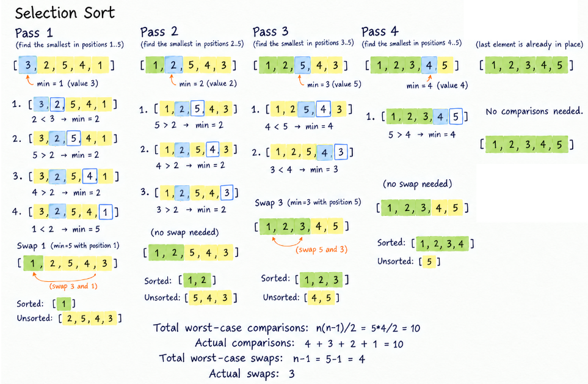

# Selection Sort in TypeScript
Selection Sort divides the array into a sorted and an unsorted portion.
The algorithm repeatedly compares elements in the unsorted portion to find the smallest element and 
places it at the end of the sorted portion.

It is called Selection Sort because each pass "selects" the smallest element and places it in its proper position
in the already sorted portion.

## How Selection Sort Works
- The sorted portion is initially empty, and the entire array is unsorted.
- Start a **pass** from the first element to the second-to-last element of the array.
- Save the current position in a temporary variable called **minIndex**.
    - Compare the element at **minIndex** with each element in the unsorted portion (right side of the array).
    - If a smaller element is found, update **minIndex** to the position of that element.
- **Swap** the smallest element found with the element at the end of the sorted portion (or the first element of
the unsorted portion).
- Repeat passes until the array is sorted.

## Selection Sort Pseudocode
```
SELECTION-SORT(A)
    for i = 1 to A.length - 1
        minIndex = i
        for j = i + 1 to A.length
            if A[j] < A[minIndex]
                minIndex = j
        exchange A[i] with A[minIndex]
```
## Selection Sort Visualization


## Complexity Analysis
For any array, Selection Sort compares each element in the unsorted portion to find the smallest element, then swaps it
with the element at the end of the sorted portion **if needed**. 

The number of comparisons is the same regardless of the initial order of the array, but the number of swaps varies
depending on the initial order.

Selection Sort performs \(n-1\) passes, with at most one swap per pass to place the smallest element at the end of 
the sorted portion.

### Worst Case
- Total comparisons: `1 + 2 + 3 + ... + (n-1) = n(n-1)/2`
- Total swaps: `n - 1 (maximum)`
- Total operations: `comparisons + swaps = (n² + n - 2)/2`
- Time Complexity: **O(n²)**

### Average Case
- Total comparisons: `1 + 2 + 3 + ... + (n-1) = n(n-1)/2`
- Total swaps: `1/2 * (n-1) ≈ (n-1)/2`
- Total operations: comparisons + swaps `n(n-1)/2 + (n-1)/2 = (n²-1)/2 ≈ n²/2`
- Time Complexity: **O(n²)**

### Best Case
- Total comparisons: `1 + 2 + 3 + ... + (n-1) = n(n-1)/2`
- Total swaps: `0`
- Time Complexity: **O(n²)**

### Space Complexity
Selection Sort is an in-place algorithm, meaning it sorts elements directly within the same array without creating 
extra arrays or lists.
The only additional memory used is a few variables, such as loop counters and a variable to store the index of the smallest element **minIndex**.

- Space complexity: **O(1)** (constant memory)

### Complexity Summary
Selection Sort performs exactly n(n-1)/2 comparisons regardless of the initial order of the array, giving **O(n²) time complexity**.

It performs **at most (n-1) swaps**, swapping the smallest element in the unsorted portion with the element at 
the end of the sorted portion (the first element of the unsorted portion), if needed.

It also has **O(1) space complexity**, since it is in-place and only uses a few extra variables.

## Selection Sort Implementations in TypeScript

```ts
function selectionSort(array: number[]): number[] {
  // Keep the classic `n` to represent the array size, useful for discussing time complexity.
  const n = array.length;

  // Stop at n - 1 because the last element will already be in the correct position.
  for (let pass = 0; pass < n - 1; pass++) {
    // `minIndex` is the index of the smallest element found.
    // `pass` is the first index of the unsorted portion.
    let minIndex = pass;

    // Find the smallest element in the unsorted portion
    for (let index = pass + 1; index < n; index++) {
      if (array[index] < array[minIndex]) {
        minIndex = index;
      }
    }

    // Swap only if the smallest element is not already in the correct position.
    if (minIndex !== pass) {
      [array[pass], array[minIndex]] = [array[minIndex], array[pass]];
    }
  }

  return array;
}
```